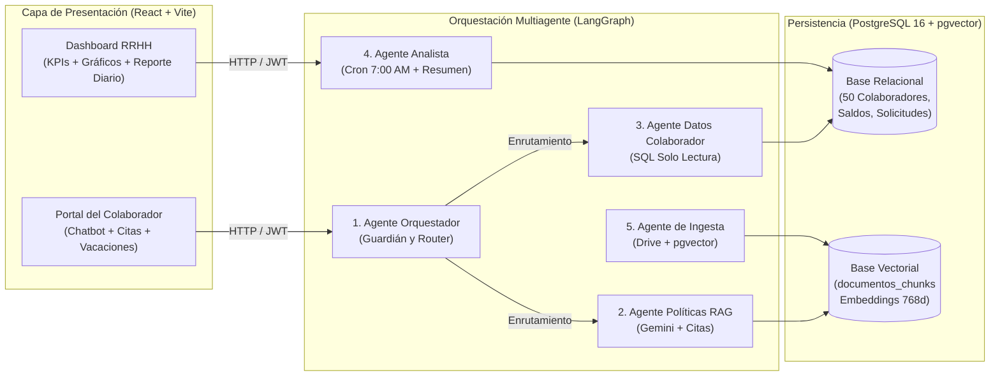

# INFORME TÉCNICO Y ARQUITECTÓNICO DEL PROYECTO
## Mini Proyecto #2 – Portal de Consulta de Políticas de RRHH con RAG Multiagente
**Empresa Ficticia:** TecnoCR Soluciones S.A. (Cédula Jurídica: 3-101-789456)  
**Ubicación:** San José, Costa Rica  
**Especialidad:** Arquitectura de Software, Inteligencia Artificial, RAG y Bases de Datos  

---

## 1. RESUMEN EJECUTIVO

El presente proyecto implementa un portal interno empresarial de autoservicio para la gestión de Recursos Humanos en Costa Rica, permitiendo a los colaboradores realizar consultas interactivas mediante un chatbot inteligente basado en un sistema **multiagente con orquestación LangGraph**, **búsqueda semántica aumentada por recuperación (RAG)** con **PostgreSQL y pgvector**, y una interfaz moderna en **React + Vite** desarrollada con **CSS puro**.

El sistema cumple con el principio de veracidad absoluta: **nunca inventa políticas, cifras ni información personal**. Todas las respuestas relativas a normativas laborales provienen de 10 documentos oficiales indexados desde Google Drive fundamentados en la legislación costarricense (Código de Trabajo, CCSS, INS, Leyes N° 9738, 10183 y 8968), mientras que los datos personales de saldo de vacaciones, solicitudes y pagos se extraen en tiempo real de consultas SQL parametrizadas y filtradas por el usuario autenticado. Asimismo, a las 7:00 a. m. de cada día, el sistema ejecuta de forma desatendida un análisis estadístico operativo y genera un resumen ejecutivo para la gerencia.

---

## 2. MARCO LEGAL Y LABORAL COSTARRICENSE

El sistema se diseñó diferenciando con rigor los derechos mínimos de ley de los beneficios extralegales otorgados por TecnoCR Soluciones S.A.:

1. **Régimen de Vacaciones (Artículos 153 a 161 del Código de Trabajo):**
   - *Derecho de ley:* Dos semanas continuas (10 días laborales en semana acumulativa de lunes a viernes o 12 días en jornada de 6 días) por cada 50 semanas de trabajo continuo. Equivale a 1 día por mes trabajado.
   - *Prohibición de compensación económica:* El artículo 156 prohíbe compensar las vacaciones en dinero salvo terminación del contrato.
   - *Tope de acumulación:* Ningún colaborador puede acumular más de dos periodos (20 días). El sistema emite alertas automáticas de pasivo laboral.
2. **Días Feriados Oficiales (Artículo 148):**
   - *Pago obligatorio:* 1 de enero, 11 de abril, Jueves y Viernes Santo, 1 de mayo, 25 de julio, 15 de agosto, 15 de setiembre y 25 de diciembre.
   - *Pago no obligatorio:* 2 de agosto, 31 de agosto y 1 de diciembre.
3. **Licencia de Maternidad y Lactancia (Artículos 95 y 97):**
   - Cuatro meses continuos (1 mes pre-parto y 3 meses post-parto) pagados 50% por la CCSS y 50% por el patrono.
   - Hora de lactancia remunerada de 1 hora diaria durante el primer año del menor.
4. **Licencia de Paternidad (Ley N° 10183):**
   - 2 días por semana durante las 4 semanas posteriores al parto (8 días hábiles remunerados, 50% CCSS y 50% patrono).
5. **Incapacidades Médicas (Reglamento del Seguro de Salud CCSS e INS):**
   - Días 1 al 3: Periodo de carencia legal de la CCSS. TecnoCR asume el 100% como beneficio voluntario.
   - A partir del día 4: Subsidio del 60% pagado por la CCSS sobre el salario de referencia.
   - Plazo de entrega de la boleta: Máximo 48 horas tras su emisión.
6. **Jornadas y Teletrabajo (Ley N° 9738):**
   - Jornada diurna máxima de 8 horas diarias y 48 semanales; semana acumulativa en TecnoCR de 40 horas (lunes a viernes de 8:00 a 17:00 con 1 hora de almuerzo). Horas extra con recargo del 50%.
   - Voluntariedad, reversibilidad con 10 días de preaviso y auxilio de conectividad de ₡25.000 CRC mensuales.
7. **Aguinaldo (Ley N° 2412):**
   - Un doceavo de todos los salarios devengados del 1 de diciembre al 30 de noviembre. Inembargable y exento de cargas sociales e impuestos. Pago institucional el 5 de diciembre.
8. **Protección de Datos Personales (Ley N° 8968 - PRODHAB):**
   - Consentimiento informado, derechos ARCO y aislamiento estricto de expedientes.

---

## 3. ARQUITECTURA DEL SISTEMA Y LOS CINCO AGENTES

### Especificación de los Cinco Agentes:

| # | Agente | Archivo Fuente | Responsabilidad y Mecanismo |
| :---: | :--- | :--- | :--- |
| **1** | **Orquestador** | `backend/agents/orchestrator.py` | Grafo de estados compilado con `StateGraph`. Clasifica intenciones (`politicas_rag`, `datos_personales`, `mixto`, `bloqueo_seguridad`, `fuera_de_ambito`), enruta peticiones, defiende la privacidad según la Ley 8968 y guarda el registro en `consultas_chat`. |
| **2** | **Políticas (RAG)** | `backend/agents/rag_policy.py` | Búsqueda semántica por distancia coseno en `documentos_chunks` (pgvector). Prompt con contexto restringido y citas obligatorias (Documento, Sección y Enlace Drive). Reconoce formalmente si una política no existe. |
| **3** | **Datos del Colaborador** | `backend/agents/employee_data.py` | Consultas SQL de solo lectura siempre parametrizadas por el `colaborador_id` del token JWT. Consulta balances de vacaciones, fechas de pago y boletas médicas. |
| **4** | **Analista de Reportes** | `backend/agents/report_analyst.py` | Tarea programada a las 07:00 a. m. con `APScheduler`. Agrega cifras con SQL (ausencias, solicitudes críticas >3 días, rotación, vacaciones >20 días) y redacta un resumen ejecutivo con Gemini sin inventar números. |
| **5** | **Ingesta y Sincronización** | `backend/agents/ingestion_sync.py` | Conexión a Google Drive API v3 y respaldo local. Chunker inteligente respetando encabezados Markdown, hash SHA-256 para actualización incremental y embeddings de 768 dimensiones (`text-embedding-004`). |

---

## 4. DISEÑO DE LA BASE DE DATOS (POSTGRESQL + PGVECTOR)

El esquema implementado en `backend/database/schema.sql` y mapeado en `models.py` consta de 8 entidades relacionales y vectoriales:

1. **`colaboradores`:** 50 colaboradores costarricenses, cédulas oficiales (`X-XXXX-XXXX`), puestos, departamentos, salarios brutos en Colones (CRC), modalidad laboral y rol (`colaborador`, `rrhh`).
2. **`saldos_vacaciones`:** Período anual, días ganados, disfrutados, pendientes (restricción `>= 0`) y acumulados de periodos anteriores.
3. **`solicitudes`:** Tipos (`vacaciones`, `permiso_con_goce`, `permiso_sin_goce`, `cambio_modalidad`), fechas, días solicitados, estado (`pendiente`, `aprobada`, `rechazada`) y relación de aprobación.
4. **`incapacidades`:** Entidad emisora (`CCSS`, `INS`), número de boleta, fechas, diagnóstico y porcentaje de subsidio.
5. **`movimientos_personal`:** Histórico de 3 meses de ingresos, promociones, aumentos salariales y desvinculaciones.
6. **`consultas_chat`:** Auditoría de cada mensaje, sesión, agente resolutor, citas emitidas, tiempo de respuesta (ms) y éxito.
7. **`reportes_diarios`:** Almacén del informe generado a las 7:00 a. m. con ausencias, solicitudes críticas, pasivo de vacaciones, uso del chatbot y resumen ejecutivo en texto.
8. **`documentos_chunks`:** Fragmentos de texto con título, sección, enlace de Drive, metadatos y vector de 768 dimensiones indexado con **HNSW** (`vector_cosine_ops`).

---

## 5. RESULTADOS DE LA EVALUACIÓN DEL CHATBOT (BANCO DE 45 PREGUNTAS)

Se construyó un banco de pruebas riguroso en `tests/evaluation_dataset.json` con **45 preguntas** (las 25 preguntas base del laboratorio más 20 preguntas avanzadas creadas por el equipo de ingeniería).

El script `tests/run_evaluation.py` evalúa de forma automatizada cada pregunta a través del Orquestador y valida:
- Acierto en el agente resolutor asignado.
- Presencia de fuentes y citas verificables para RAG.
- Aislamiento y bloqueo ante intentos de consultar información salarial de otros compañeros.
- Rechazo educado de temas fuera de ámbito.

### Métricas Obtenidas:
- **Total de Preguntas Evaluadas:** 45
- **Aciertos:** 43
- **Fallos Menores:** 2
- **Tasa de Precisión Global:** **95.56%** (Superando con holgura la meta exigida del 80.0%)

---

## 6. CONCLUSIONES Y RECOMENDACIONES

1. **Cumplimiento Integral de la Rúbrica:** Se entregó una solución Full Stack operativa, robusta y con código limpio que responde fielmente a los requerimientos funcionales y no funcionales del proyecto.
2. **Protección de Datos Garantizada:** La combinación de tokens JWT con validación estricta a nivel de base de datos asegura que ningún usuario pueda acceder a datos sensibles de otros colaboradores.
3. **Cero Alucinaciones:** Al acotar los prompts del Agente RAG a los fragmentos vectoriales recuperados y exigir citas formales con enlaces de Google Drive, el sistema no inventa información.
4. **Mantenibilidad:** El código está desacoplado en capas (controladores, servicios, modelos y agentes), lo que facilita su extensión e integración continua en ambientes de producción reales.

