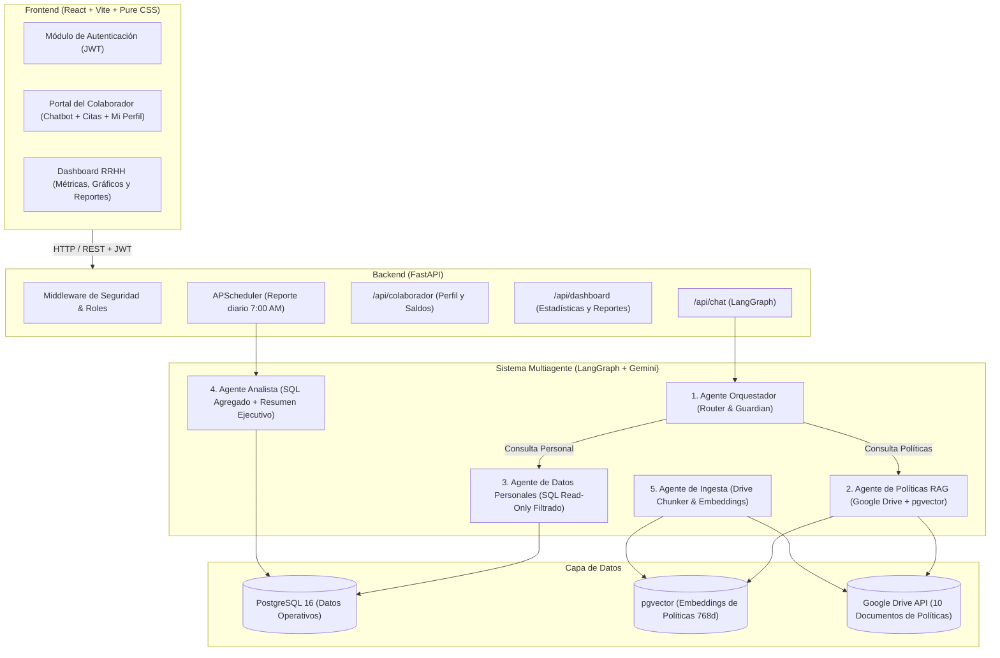

# Portal de Recursos Humanos con RAG Multiagente (Costa Rica)
## Mini Proyecto #2 - Arquitectura de Software y Sistemas Inteligentes

Portal web interno de Recursos Humanos para la empresa ficticia costarricense **TecnoCR Soluciones S.A.** (Cédula Jurídica: 3-101-789456), que permite a los colaboradores consultar políticas de la empresa y su información laboral personalizada mediante un sistema multiagente inteligente y seguro.

---

## 🏛️ 1. Arquitectura General del Sistema

El sistema implementa una arquitectura desacoplada y orientada a agentes:



---

## 🤖 2. Los Cinco Agentes Especializados

| Agente | Responsabilidad | Fuentes y Herramientas |
| :--- | :--- | :--- |
| **1. Orquestador** | Clasifica la intención del usuario, enruta la pregunta, rechaza temas ajenos a RRHH y bloquea intentos de consultar salarios o datos privados de terceros. | Reglas de clasificación, LangGraph StateGraph, Gemini Flash. |
| **2. Políticas (RAG)** | Responde preguntas sobre normas laborales, beneficios, feriados de Costa Rica e incapacidades. Solo responde con información fundamentada y genera citas con documento, sección y enlace. | Búsqueda vectorial con similitud coseno en `pgvector`, Gemini Flash. |
| **3. Datos del Colaborador** | Consulta en tiempo real las vacaciones disponibles, solicitudes y fechas de pago del usuario autenticado. | Consultas SQL parametrizadas de solo lectura filtradas por `colaborador_id`. |
| **4. Analista de Reportes** | Ejecuta diariamente a las 7:00 a. m. el consolidado de ausencias, solicitudes pendientes críticas (>3 días), incapacidades activas, rotación y alertas de vacaciones (>20 días). | Consultas SQL de agregación + Gemini para redacción ejecutiva. |
| **5. Ingesta y Sincronización** | Descarga periódicamente los documentos desde Google Drive, detecta cambios mediante hash SHA-256, genera fragmentos (chunks) y calcula embeddings en pgvector. | Google Drive API v3, LangChain Text Splitters, Gemini Embeddings (`text-embedding-004`). |

---

## 📁 3. Estructura de Directorios del Proyecto

```text
rhh/
├── .env.example                     # Plantilla de variables de entorno
├── .env                             # Variables de entorno locales (credenciales)
├── README.md                        # Documentación técnica y guía de instalación
│
├── backend/                         # Backend Python + FastAPI
│   ├── requirements.txt             # Dependencias del servidor y agentes
│   ├── main.py                      # Punto de entrada de la API FastAPI
│   ├── config.py                    # Configuración centralizada de Pydantic
│   ├── database/                    # Capa de datos y persistencia
│   │   ├── __init__.py
│   │   ├── connection.py            # Conexión SQLAlchemy y pgvector
│   │   ├── models.py                # Modelos ORM de las 8 tablas
│   │   ├── schema.sql               # Script DDL SQL con llaves, índices y restricciones
│   │   ├── seed_data.py             # Generador de 50 colaboradores costarricenses y 3 meses
│   │   └── test_db.py               # Script de verificación de base de datos
│   ├── agents/                      # Los 5 Agentes de LangGraph
│   │   ├── __init__.py
│   │   ├── orchestrator.py          # Agente 1: Orquestador & Guardian
│   │   ├── rag_policy.py            # Agente 2: RAG de Políticas de RRHH
│   │   ├── employee_data.py         # Agente 3: Consultas de datos de colaborador (SQL)
│   │   ├── report_analyst.py        # Agente 4: Generador de reportes diarios de las 7:00 AM
│   │   └── ingestion_sync.py        # Agente 5: Ingesta de Google Drive a pgvector
│   ├── services/                    # Lógica de negocio y servicios auxiliares
│   │   ├── auth_service.py          # Hashing bcrypt y generación de tokens JWT
│   │   ├── drive_service.py         # Integración y lectura de Google Drive API
│   │   └── scheduler_service.py     # Programador de tareas de reportes diarios
│   └── routes/                      # Endpoints REST de FastAPI
│       ├── auth_routes.py           # /api/auth/login y /api/auth/me
│       ├── chat_routes.py           # /api/chat/message y /api/chat/history
│       ├── employee_routes.py       # /api/colaborador/perfil y solicitudes
│       └── dashboard_routes.py      # /api/dashboard/stats y reportes
│
├── docs_politicas/                  # Los 10 Documentos de Políticas de RRHH (Normativa CR)
│   ├── 01_politica_vacaciones_feriados.md
│   ├── 02_politica_permisos_licencias.md
│   ├── 03_procedimiento_incapacidades.md
│   ├── 04_reglamento_jornada_teletrabajo.md
│   ├── 05_politica_salarial_pagos.md
│   ├── 06_catalogo_beneficios.md
│   ├── 07_manual_onboarding_salida.md
│   ├── 08_politica_evaluacion_desempeno.md
│   ├── 09_codigo_conducta_denuncias.md
│   └── 10_aviso_privacidad_colaboradores.md
│
├── tests/                           # Evaluación del Chatbot (45 preguntas)
│   ├── evaluation_dataset.json      # Banco de 45 preguntas (25 base + 20 adicionales)
│   └── run_evaluation.py            # Evaluador automatizado del 80% de precisión
│
└── frontend/                        # Frontend React + Vite (JavaScript + CSS puro)
    ├── package.json
    ├── vite.config.js
    ├── index.html
    └── src/
        ├── App.jsx
        ├── main.jsx
        ├── styles/
        │   ├── variables.css        # Paleta corporativa, tipografía y sombras
        │   ├── layout.css           # Grid, navegación y contenedores
        │   ├── chat.css             # Burbujas de chat, citas y fuentes desplegables
        │   └── dashboard.css        # Indicadores numéricos y tarjetas estadísticas
        ├── context/
        │   └── AuthContext.jsx      # Estado de sesión y control de roles
        ├── components/
        │   ├── Navbar.jsx           # Navegación superior con indicador de rol
        │   ├── Chatbot.jsx          # Ventana interactiva de chat con citas
        │   ├── VacationCard.jsx     # Tarjeta de saldo y solicitudes de vacaciones
        │   └── StatCard.jsx         # Tarjetas de KPI para RRHH
        └── pages/
            ├── LoginPage.jsx        # Pantalla de inicio de sesión
            ├── ColaboradorPage.jsx  # Portal principal del empleado
            └── DashboardPage.jsx    # Dashboard ejecutivo exclusivo de RRHH
```

---

## 🚀 4. Requisitos Previos

- **Node.js**: Versión 18+ instalada (`node -v`).
- **Python**: Versión 3.10+ instalada (`python --version`).
- **PostgreSQL**: Versión 15+ con extensión `pgvector`.

